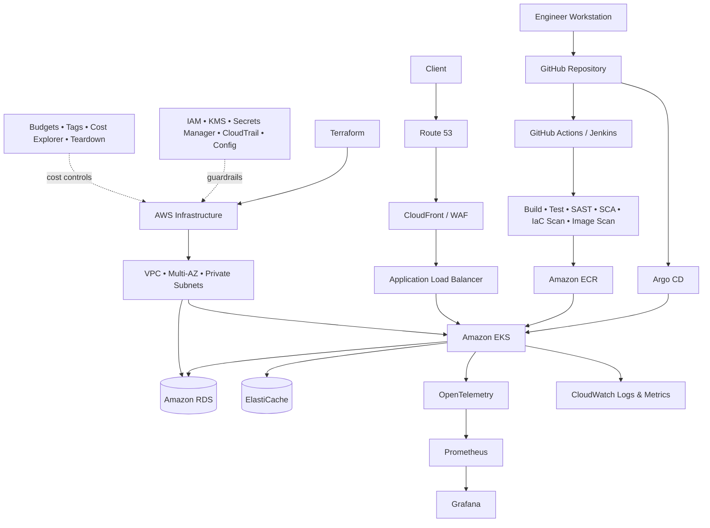

<div align="center">

# ☁️ AWS CLOUD • DEVOPS • PLATFORM ENGINEERING

## Production Mastery Portfolio

### A zero-assumption, execution-first journey from Linux fundamentals to secure AWS platform delivery

[](https://aws.amazon.com/)
[](https://developer.hashicorp.com/terraform)
[](https://docs.docker.com/)
[](https://kubernetes.io/)
[](https://docs.github.com/actions)
[](#-security-engineering)
[](https://argo-cd.readthedocs.io/)
[](#-progress-dashboard)

<br>

**Linux** → **Networking** → **Git** → **Automation** → **AWS** → **Terraform** → **Docker** → **CI/CD** → **Kubernetes/EKS** → **Helm** → **Ansible** → **Observability** → **DevSecOps** → **GitOps** → **SRE/DR** → **FinOps**

<br>

> **Portfolio principle:** Every skill is demonstrated with architecture, implementation, validation, controlled failure, recovery, security review, cost review, screenshots, and interview explanation.

</div>

---

## 🌟 Repository Mission

This repository is designed as a **self-contained engineering academy and evidence portfolio**, not a command dump. A complete beginner can follow the learning path in order, while an interviewer can inspect the architecture, source code, infrastructure, pipelines, operational evidence, failure investigations, and recovery procedures.

> [!IMPORTANT]
> Thirty days of focused practice can build strong foundations, interview readiness, and a credible project portfolio. It cannot honestly replace several years of production ownership. This repository therefore avoids unsupported experience claims and emphasizes demonstrable engineering evidence.

## 🧭 Mastery Journey

```mermaid
flowchart LR
    F1[Linux] --> F2[Networking]
    F2 --> F3[Git & Automation]
    F3 --> C1[AWS Foundations]
    C1 --> C2[Secure AWS Architecture]
    C2 --> I1[Terraform IaC]
    I1 --> D1[Docker]
    D1 --> P1[CI/CD]
    P1 --> K1[Kubernetes & EKS]
    K1 --> O1[Observability]
    O1 --> S1[DevSecOps]
    S1 --> G1[Argo CD GitOps]
    G1 --> R1[SRE, DR & FinOps]
    R1 --> Z1[Production Capstone]
```



## 🏗️ Production Reference Architecture



## 📚 Premium Knowledge Library

| Academy | Scope | Documentation |
|---|---|---|
| 🐧 Systems | Linux, shell, services, logs, storage | [`academy/01-linux`](academy/01-linux/README.md) |
| 🌐 Networks | TCP/IP, DNS, TLS, CIDR, routing | [`academy/02-networking`](academy/02-networking/README.md) |
| 🌿 Source Control | Git internals, branches, recovery, PRs | [`academy/03-git-github`](academy/03-git-github/README.md) |
| ⚙️ Automation | Bash, Python, APIs, safe scripting | [`academy/04-automation`](academy/04-automation/README.md) |
| ☁️ AWS | IAM, compute, storage, data, network, security | [`academy/05-aws`](academy/05-aws/README.md) |
| 🏗️ IaC | Terraform state, modules, testing, drift | [`academy/06-terraform`](academy/06-terraform/README.md) |
| 🐳 Containers | Docker images, Compose, security | [`academy/07-docker`](academy/07-docker/README.md) |
| 🚀 Delivery | GitHub Actions, Jenkins, release strategies | [`academy/08-cicd`](academy/08-cicd/README.md) |
| ☸️ Platform | Kubernetes, EKS, Helm, scheduling, security | [`academy/09-kubernetes`](academy/09-kubernetes/README.md) |
| 🔧 Configuration | Ansible and idempotent operations | [`academy/10-ansible`](academy/10-ansible/README.md) |
| 📊 Observability | Metrics, logs, traces, alerting, SLOs | [`academy/11-observability`](academy/11-observability/README.md) |
| 🔐 Security | DevSecOps, SBOM, policy and supply chain | [`academy/12-devsecops`](academy/12-devsecops/README.md) |
| 🌳 GitOps | Argo CD reconciliation and promotion | [`academy/13-gitops`](academy/13-gitops/README.md) |
| 🔥 Reliability | Incidents, DR, SRE and FinOps | [`academy/14-sre-finops`](academy/14-sre-finops/README.md) |

## 🧪 Engineering Evidence Model

```text
Concept → Architecture → Build → Verify → Break → Diagnose → Recover
       → Secure → Measure → Optimize Cost → Document → Explain
```

Each milestone requires:

- A clear objective and prerequisite list
- Architecture and request-flow diagram
- Exact commands with placeholders explained
- Expected output and validation criteria
- One controlled failure scenario
- Symptoms, evidence, investigation, root cause, fix and rollback
- Security and least-privilege review
- AWS cost impact and teardown instructions
- Screenshot index and committed text evidence
- Interview questions from beginner to architect level


## 🎨 Day-by-Day Premium Learning System

Every day from **Day 01 through Day 30** includes seven GitHub-rendered documents with emojis, Mermaid diagrams, copy-ready command blocks, colourful badges/callouts, production tables, lab notes, troubleshooting runbooks, summaries, and **10 hardcore interview questions with model answers**.

| Daily document | Purpose |
|---|---|
| `README.md` | Premium mission page, badges, learning flow and exit gates |
| `CONCEPTS.md` | Concept maps, architecture questions and mastery tables |
| `COMMANDS.md` | Copy-ready commands, purpose and validation evidence |
| `LAB-NOTES.md` | Architecture, journal, failure injection and screenshots |
| `INTERVIEW-QA.md` | 10 detailed Q&As plus architect-level challenge |
| `TROUBLESHOOTING.md` | Evidence-driven runbook and root-cause template |
| `SUMMARY.md` | Completion scorecard and interview narrative |

[Open the 30-day roadmap](roadmap/30-DAY-EXECUTION-PLAN.md) • [Open Day 01](days/day-01-linux-foundation-i/README.md)

## 📈 Progress Dashboard

| Phase | Days | Status | Portfolio outcome |
|---|---:|---|---|
| Foundation Engineering | 01–05 | ⬜ | Linux, networking, Git and automation evidence |
| AWS Cloud Core | 06–14 | ⬜ | Secure, monitored multi-AZ AWS application |
| Infrastructure & Delivery | 15–18 | ⬜ | Reusable IaC, container and CI/CD workflow |
| Kubernetes Platform | 19–22 | ⬜ | EKS/Helm/Ansible delivery platform |
| Production Operations | 23–28 | ⬜ | Observability, security, GitOps, DR and FinOps |
| Capstone & Interview | 29–30 | ⬜ | End-to-end project and interview narrative |

## 🚀 Quick Start

```bash
git clone YOUR_REPOSITORY_URL
cd AWS-Cloud-DevOps-Master-Portfolio
bash scripts/bootstrap/validate-host.sh
bash scripts/quality/validate-repository.sh
```

Then read:

1. [`START-HERE.md`](START-HERE.md)
2. [`roadmap/30-DAY-EXECUTION-PLAN.md`](roadmap/30-DAY-EXECUTION-PLAN.md)
3. [`roadmap/DAILY-OPERATING-MODEL.md`](roadmap/DAILY-OPERATING-MODEL.md)
4. [`academy/01-linux/README.md`](academy/01-linux/README.md)

## ✅ Portfolio Quality Gates

- [ ] Fresh-clone bootstrap is documented and repeatable
- [ ] No credentials, keys, tokens, state files, or private data are committed
- [ ] Automated repository checks pass
- [ ] Architecture decisions and trade-offs are documented
- [ ] Tests include positive, negative, recovery, and regression paths
- [ ] Deployment is observable and rollback-capable
- [ ] AWS resources have ownership, environment, cost-center, and expiry tags
- [ ] Backup and recovery are exercised, not merely described
- [ ] Screenshots support evidence but do not replace source and text logs
- [ ] Interview claims match committed evidence

---

<div align="center">

### Build it • Break it • Observe it • Recover it • Explain it

**Designed as an interview-ready Cloud, DevOps, DevSecOps, SRE and Platform Engineering portfolio**

</div>
