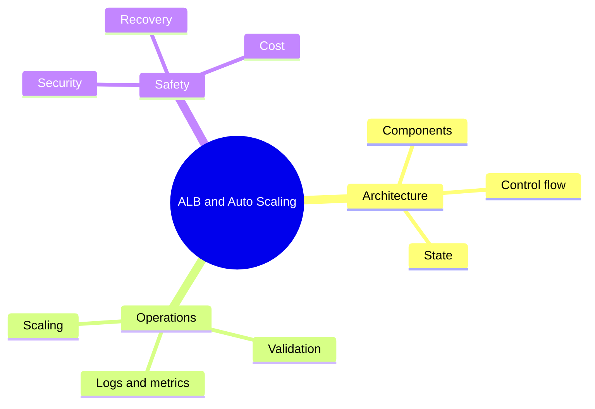

# 🧠 Day 12 • ALB and Auto Scaling • Concepts

[README.md](README.md) | [CONCEPTS.md](CONCEPTS.md) | [COMMANDS.md](COMMANDS.md) | [LAB-NOTES.md](LAB-NOTES.md) | [INTERVIEW-QA.md](INTERVIEW-QA.md) | [TROUBLESHOOTING.md](TROUBLESHOOTING.md) | [SUMMARY.md](SUMMARY.md)

## 🌈 Concept map

## 📚 Mastery table

| # | Concept | Required depth |
|---:|---|---|
| 1 | **target groups** | Explain purpose, internal flow, state, failure modes and validation |
| 2 | **health checks** | Explain purpose, internal flow, state, failure modes and validation |
| 3 | **launch templates** | Explain purpose, internal flow, state, failure modes and validation |
| 4 | **scaling policies and Multi-AZ resilience** | Explain purpose, internal flow, state, failure modes and validation |

## 🏗️ Architecture thinking

| Question | Your documented answer must cover |
|---|---|
| What initiates the flow? | User, API, CLI, pipeline or controller |
| Where is state? | File, service, database, state backend or control plane |
| What grants access? | Identity, role, policy, RBAC, network boundary |
| What proves health? | Status, logs, events, metrics, traces and functional checks |
| How does it fail? | Config, permission, network, dependency, capacity or release |
| How is it recovered? | Fix, rollback, restore, failover and regression validation |

> [!TIP]
> Never memorize a definition alone. Connect every concept to one command, one validation signal, one failure and one interview example.
