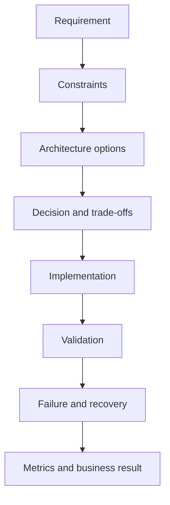

# 🎤 Day 12 • ALB and Auto Scaling • Hardcore Interview Q&A

[README.md](README.md) | [CONCEPTS.md](CONCEPTS.md) | [COMMANDS.md](COMMANDS.md) | [LAB-NOTES.md](LAB-NOTES.md) | [INTERVIEW-QA.md](INTERVIEW-QA.md) | [TROUBLESHOOTING.md](TROUBLESHOOTING.md) | [SUMMARY.md](SUMMARY.md)

> [!NOTE]
> Speak each answer using **context → architecture → implementation → evidence → failure → recovery → trade-off → result**.

### 1. ❓ What business or operational problem does ALB and Auto Scaling solve?

**Model answer:** ALB and Auto Scaling provides the aws resilience capabilities needed to manage target groups, health checks, launch templates, scaling policies and Multi-AZ resilience. In this portfolio the proof is the lab: deploy a load-balanced, auto-scaled web tier. A strong answer connects the technology to reliability, repeatability, security and measurable validation rather than only definitions.

**Follow-up depth:** Give one command, one failure signal, one rollback path and one trade-off from the Day 12 lab.

### 2. ❓ Explain the normal control or request flow for ALB and Auto Scaling.

**Model answer:** Start with the initiating user, pipeline or API request, follow configuration and identity evaluation, then runtime execution, dependencies, state, telemetry and the final response. For ALB and Auto Scaling, draw this flow and identify where each topic fits: target groups, health checks, launch templates, scaling policies and Multi-AZ resilience.

**Follow-up depth:** Give one command, one failure signal, one rollback path and one trade-off from the Day 12 lab.

### 3. ❓ How do you verify that the implementation is healthy?

**Model answer:** Use layered evidence: configuration validation, runtime status, logs/events, metrics, an end-to-end functional test and a negative test. For this day, the implementation is not complete until the outcome "Deploy a load-balanced, auto-scaled web tier" is demonstrated and recovery is validated.

**Follow-up depth:** Give one command, one failure signal, one rollback path and one trade-off from the Day 12 lab.

### 4. ❓ What are the most likely production failure modes?

**Model answer:** The main categories are incorrect configuration, permission denial, network reachability, dependency failure, resource saturation, stale state, release regression and missing observability. Scope the failure first, inspect recent changes, then prove one causal mechanism.

**Follow-up depth:** Give one command, one failure signal, one rollback path and one trade-off from the Day 12 lab.

### 5. ❓ How do you troubleshoot without guessing?

**Model answer:** Capture the timestamp and symptom, define scope, inspect the most recent change, trace the request/control path, collect status, logs, events, metrics, traces and audit evidence, test hypotheses one at a time, then validate the fix and rollback.

**Follow-up depth:** Give one command, one failure signal, one rollback path and one trade-off from the Day 12 lab.

### 6. ❓ What security controls should be applied?

**Model answer:** Apply least privilege, short-lived identity, encryption in transit and at rest, secret separation, audit logging, secure defaults, protected changes and vulnerability/policy gates appropriate to AWS Resilience. Document trust boundaries and avoid committing credentials or state.

**Follow-up depth:** Give one command, one failure signal, one rollback path and one trade-off from the Day 12 lab.

### 7. ❓ How do you design rollback and recovery?

**Model answer:** Define a known-good artifact/configuration, explicit rollback trigger, state/data compatibility, backup or snapshot where needed, command sequence, validation checks and owner. Recovery must be exercised during the lab, not merely documented.

**Follow-up depth:** Give one command, one failure signal, one rollback path and one trade-off from the Day 12 lab.

### 8. ❓ How do you make the solution highly available and scalable?

**Model answer:** Remove single points of failure, distribute across failure domains when the technology supports it, use health-based routing, capacity signals, automation and tested failover. Explain stateful constraints before claiming horizontal scalability.

**Follow-up depth:** Give one command, one failure signal, one rollback path and one trade-off from the Day 12 lab.

### 9. ❓ What should be monitored and alerted on?

**Model answer:** Monitor user-visible success, latency, errors, saturation, dependency health, deployment/configuration changes and security/audit signals. Alerts should have an owner, threshold rationale, runbook and action, and should avoid noisy symptoms without impact.

**Follow-up depth:** Give one command, one failure signal, one rollback path and one trade-off from the Day 12 lab.

### 10. ❓ What cost and operational trade-offs matter?

**Model answer:** Compare managed versus self-managed operations, availability level, data retention, network transfer, idle capacity, logging volume and recovery objectives. Tag resources, set budgets, inventory retained services and include teardown evidence.

**Follow-up depth:** Give one command, one failure signal, one rollback path and one trade-off from the Day 12 lab.

## 🧱 Architect-level challenge

**Challenge:** Redesign the Day 12 solution for regulated production use. Cover identity, encryption, availability, audit, recovery, safe deployment, operational ownership and cost.
