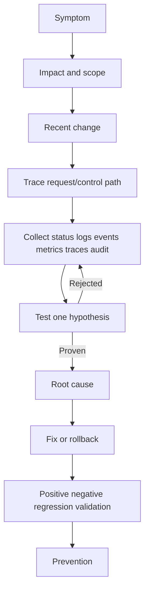

# 🚨 Day 16 • Terraform Production Patterns • Troubleshooting Runbook

[README.md](README.md) | [CONCEPTS.md](CONCEPTS.md) | [COMMANDS.md](COMMANDS.md) | [LAB-NOTES.md](LAB-NOTES.md) | [INTERVIEW-QA.md](INTERVIEW-QA.md) | [TROUBLESHOOTING.md](TROUBLESHOOTING.md) | [SUMMARY.md](SUMMARY.md)

## Investigation flow

## Production scenario table

| Scenario | Evidence | Likely areas | Recovery gate |
|---|---|---|---|
| Component unavailable | Status, listener, logs, dependency checks | Process, config, network, dependency | End-to-end request succeeds |
| Permission denied | Acting identity, effective policy/RBAC, audit log | Wrong principal, missing allow, explicit deny | Required action succeeds; excess access denied |
| Configuration drift | Desired vs deployed vs runtime state | Manual change, stale branch, wrong environment | Authorized source reconciles state |
| Performance degradation | Latency, errors, saturation, traces | Capacity, dependency, lock, retry storm | Baseline and SLO restored |
| Failed release | Version, diff, events, health checks | Artifact, config, migration, compatibility | Known-good version restored |

## Root-cause record

| Section | Details |
|---|---|
| Symptoms | |
| Business/user impact | |
| Scope | |
| Timeline | |
| Recent change | |
| Evidence | |
| Root cause | |
| Immediate mitigation | |
| Permanent fix | |
| Rollback | |
| Prevention | |
| Security/cost impact | |
