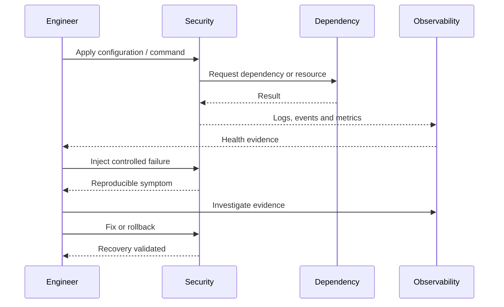

# 🧪 Day 25 • DevSecOps and Supply Chain • Production Lab Notes

[README.md](README.md) | [CONCEPTS.md](CONCEPTS.md) | [COMMANDS.md](COMMANDS.md) | [LAB-NOTES.md](LAB-NOTES.md) | [INTERVIEW-QA.md](INTERVIEW-QA.md) | [TROUBLESHOOTING.md](TROUBLESHOOTING.md) | [SUMMARY.md](SUMMARY.md)

## 🎯 Lab objective

Force the pipeline to reject an unsafe change.

## 🏗️ Lab architecture

## 🧰 Prerequisites

- [ ] Correct branch and clean working tree
- [ ] Tool/version captured
- [ ] AWS account/region verified when applicable
- [ ] Cost drivers and teardown identified
- [ ] Secrets excluded from terminal history and Git
- [ ] Screenshot directory created

## 📝 Execution journal

| Time | Command/change | Expected | Actual | Evidence path |
|---|---|---|---|---|
| | | | | |
| | | | | |
| | | | | |

## 💥 Controlled failure

| Field | Record |
|---|---|
| Failure injected | |
| User-visible symptom | |
| Scope | |
| Recent change | |
| Evidence collected | |
| Root cause | |
| Fix | |
| Rollback | |
| Prevention | |

## 📸 Required screenshots

1. `docs/assets/screenshots/day25/01-environment.png`
2. `docs/assets/screenshots/day25/02-architecture.png`
3. `docs/assets/screenshots/day25/03-success.png`
4. `docs/assets/screenshots/day25/04-controlled-failure.png`
5. `docs/assets/screenshots/day25/05-recovery.png`
6. `docs/assets/screenshots/day25/06-cleanup.png`
7. `docs/assets/screenshots/day25/07-git-evidence.png`

## 🔐 Security and 💰 cost review

- Identity and effective permissions:
- Public exposure:
- Secrets and sensitive state:
- Encryption:
- Audit evidence:
- Billable resources:
- Teardown result:
