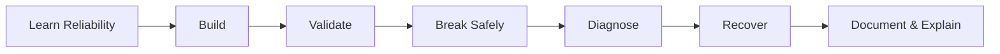

# 🚀 Day 28 • Disaster Recovery and FinOps

### Reliability • Production Practice • Interview Evidence

---

[README.md](README.md) | [CONCEPTS.md](CONCEPTS.md) | [COMMANDS.md](COMMANDS.md) | [LAB-NOTES.md](LAB-NOTES.md) | [INTERVIEW-QA.md](INTERVIEW-QA.md) | [TROUBLESHOOTING.md](TROUBLESHOOTING.md) | [SUMMARY.md](SUMMARY.md)

> [!IMPORTANT]
> Day 28 is complete only after implementation, validation, a controlled failure, evidence-based troubleshooting, recovery, security review, cost cleanup, screenshots and interview answers.

## 🎯 Mission

**Restore a backup and prove removal of unneeded AWS resources.**

## 🧠 Core scope

| Area | Coverage |
|---|---|
| Domain | Reliability |
| Concepts | RTO, RPO, backups, replication, restore testing, tags, budgets, rightsizing and teardown |
| Practice | Restore a backup and prove removal of unneeded AWS resources |
| Evidence | Commands, outputs, failure record, recovery and screenshots |
| Interview | 10 detailed questions with model answers |

## 🗺️ Learning flow

## ⏱️ 9–10 hour plan

| Block | Activity | Output |
|---|---|---|
| 2h | Concepts and architecture | `CONCEPTS.md` notes and diagram |
| 4h | Guided hands-on | Working lab and command evidence |
| 1.5h | Controlled failure | Root-cause and recovery record |
| 1h | Interview drill | Spoken Q&A without notes |
| 1h | Documentation and Git | Screenshots, summary and commit |
| 0.5h | Security/cost cleanup | Inventory and teardown evidence |

## ✅ Exit gate

- [ ] Architecture explained without reading
- [ ] Commands executed with expected observations
- [ ] Lab objective demonstrated
- [ ] Failure reproduced and root cause proven
- [ ] Rollback/recovery exercised
- [ ] Security and cost reviewed
- [ ] Interview Q&A spoken aloud
- [ ] Git quality checks passed
